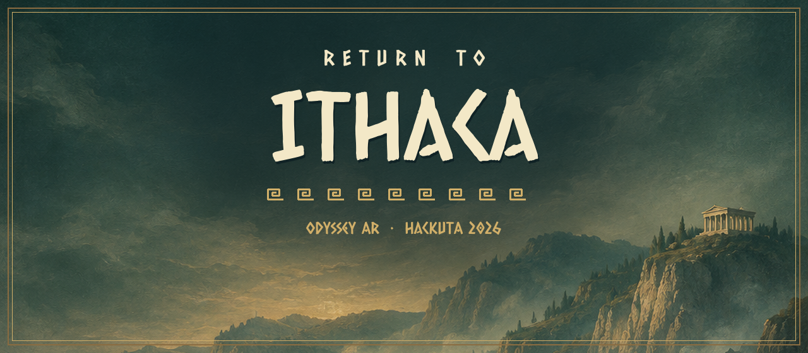

<p align="center">
  
</p>

<h1 align="center">Odyssey AR</h1>
<p align="center"><i>Ten years after Troy, you still haven't made it home.</i><br>
An augmented-reality quest across your real streets for iPhone. Built in 18 hours at <b>HackUTA 2026</b>.</p>

<p align="center">
  
  
  
  
  
  
</p>

## The story
You are Odysseus. Somewhere in the streets around you lies **Ithaca**, and the gods have hidden it well. Through your phone's camera the old monsters stand in the real world, waiting.

- **The Cyclops** blocks the road, his one eye healed and furious. Tap to strike, raise your shield to survive.
- **Medusa** seizes your screen and watches you through the front camera. Look at her with your eyes open for half a second and you are **stone**. Close your eyes. Look away. Listen to her hiss.
- **The Sphinx** will only talk, out loud. Answer her riddles while she mocks your deaths and your sense of direction. Solve two and she leans in to share the secret she's been guarding:

> *"Fine. A deal is a deal. Lean closer, sailor... Ithaca is... Not here."*

Keep walking. You'll know Ithaca when you see the flag.

## What makes it different
- **A monster you must not look at.** ARKit face tracking runs on the hidden TrueDepth camera and reads your blinks and gaze. The feed is never shown, but the danger is real.
- **A boss you defeat with your voice.** Speech goes to our server. ElevenLabs transcribes it, Gemini judges the answer and writes the Sphinx's reply in character, and ElevenLabs speaks it back, in about 2 seconds. She can't be talked into accepting a wrong answer.
- **One painted world.** The UI, Medusa's takeover video and the 3D assets share a moonlit oil-painting style.

## How we built it
```
iPhone · Unity 2019.4 + AR Foundation/ARKit + Mapbox          Laptop · Python FastAPI
  GPS voyage map ── encounters placed around you
  Cyclops   rear-camera AR fight
  Medusa    ARKit face tracking → blink + gaze → STONED
  Sphinx    hold to speak → WAV ──── /sphinx/talk ────▶  ElevenLabs speech-to-text
            subtitles + her voice ◀── JSON + WAV ──────  Gemini (persona, judging)
                                                         ElevenLabs text-to-speech
```

## Challenges we ran into
- **Legacy Unity, for the first time.** None of us had used Unity 2019 before, and it took almost **6 hours** of trial and error just to get the app running on our iPhones: version-locked packages, Xcode export fixes, and AR plugins built for an older iOS.
- **Face tracking on an old AR stack.** AR Foundation 3.1 can't simply switch to the front camera, so Medusa pauses rear AR, swaps the session to face tracking with the feed hidden, then restores AR exactly as it was.
- **Speed.** Gemini's "thinking" models took over 15 s, past the phone's 8 s wait. Switching to Flash-Lite brought replies to about 1 s, with time held back for her voice.
- **A 600,000-triangle Sphinx.** We cut the 3D scan to 10k triangles and re-baked its texture in Python so it runs smoothly on a phone.

## Run it
- **Game:** open `iOS_MapStoryEngine/` in Unity **2019.4.41f2**, scene `Assets/StoryEngine/Scenes/MapStory.unity`. Each encounter also runs on its own from `Assets/Game/Sandbox/`. See [`TEAM_SETUP.md`](TEAM_SETUP.md) for keys and [`changes.md`](changes.md) for the iOS build.
- **Sphinx server:** `pip install -r server/requirements.txt`, put your Gemini and ElevenLabs keys in `server/.env`, then run `python -m server` (`--fake` runs with no keys). See [`server/README.md`](server/README.md).

## Team
**Thongum Athoiba** · **Adib Bin Kadir** · **Farhan Ishraq Khan** · **Tahmid Wasif**

## Credits
Built on graeburn's [Map Story engine](docs/MAPSTORY_ENGINE.md) (MIT).
- **3D models (Sketchfab):** Cyclops Rig by DM-913 (CC BY 4.0), Medieval Flag by Sousinho (CC BY 4.0), and the Sphinx of Hatshepsut scan.
- **Font:** Caesar Dressing by Open Window (OFL).
- **Medusa's video and the Sphinx's voice** are AI-generated (the voice with ElevenLabs); Google Gemini writes the Sphinx's lines.

MIT License.
